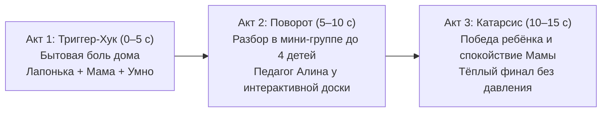

# Контент-Baseline UMNOLAND: Аналитика триггеров РФ (1–4 класс) и Голливудская драматургия 15-секундных Reels

> [!NOTE]
> Полный дословный текст книги защищён авторским правом, поэтому ниже собрана **концентрированная практическая выжимка (конспект-методичка)** ключевых правил голливудского сценарного мастерства, переложенная специально на хронометраж 15-секундных 3D Pixar-роликов в Google Vids (`Omni`). Этот же стандарт сохранён в проект как постоянный baseline: [content_baseline.md](file:///Users/glebpudovkin/Desktop/контентзавод/data/capsules/umnoland/content_baseline.md).

---

## Часть 1. Конспект-выжимка: «Голливудская драматургия за 15 секунд»

В классической голливудской сценарной школе (от коротких практических пособий для сценаристов до канонов *Show, Don't Tell*) любой захватывающий сюжет — будь то полный метр на 120 минут или вертикальный Reel на 15 секунд — держится на **5 жёстких правилах**:

### 1. Правило «Крючка в действии» (*In Media Res* — Первые 2–3 секунды)
* **Ошибка новичков:** начинать с приветствия, экспозиции или общей фразы («Привет, сегодня поговорим про школу…»).
* **Как делают в Голливуде:** зритель попадает **в самый пик конфликта**. Камера сразу показывает физическое действие и острую эмоцию: надломленный карандаш, ластик, протёрший тетрадь до дырки, часы, показывающие `21:45`, и вздох мамы.

### 2. Правило «Двойной ставки» (*External Problem vs. Internal Pain*)
* У любой сцены есть **внешняя проблема** (ребёнок не может решить задачу в 2 действия или прочитать текст) и **внутренняя боль** родителя (*«Я плохая мать, я кричу на своего ребёнка каждый вечер и порчу наши отношения»*).
* **Триггер покупает не решение задачи по математике, а возвращение мира в семью.**

### 3. Правило «Покажи, а не расскажи» (*Show, Don't Tell*)
* В 3D-анимации нельзя ставить «говорящую голову» на пустом фоне.
* Эмоция передаётся через **микро-действия персонажей**:
  * *Бессилие:* Лапонька кладёт голову на раскрытую тетрадь, воробей Умно пытается поднять слишком тяжёлый учебник.
  * *Понимание (Aha-момент):* глаза Лапоньки расширяются, спина выпрямляется, рука тянется вверх.

### 4. Правило «Поворотной точки через наставника» (*The Guide / Mentor Twist*)
* В голливудской структуре герой (Ребёнок и Мама) сам не может выбраться из тупика — иначе зритель не поймёт ценность продукта.
* Появляется **Наставник** (Педагог Алина в мини-группе до четырёх детей), который **меняет оптику**: вместо зубрёжки и давления даёт наглядный игровой приём.

### 5. Правило «Эмоциональной разрядки» (*Catharsis & Payoff*)
* Последние 3–4 секунды должны давать зрителю **физическое ощущение облегчения**. Контраст света и поз: от сгорбленной позы под настольной лампой — к тёплому объятию Мамы и победному жесту Лапоньки.

---

## Часть 2. Аналитика триггерных проблем младших школьников в РФ (1–4 класс)

На основе реальных болей российских родителей учеников начальной школы (программы «Школа России», «Перспектива», Петерсон, подготовка к ВПР) выделены **5 самых острых бытовых триггеров**, которые дают максимальное удержание (Retention) и репосты в родительские чаты:

| № | Триггерная проблема (РФ, 1–4 класс) | Бытовая картинка («Как это выглядит дома в 21:00») | Внутренняя боль мамы (почему покупают UMNOLAND) |
| :--- | :--- | :--- | :--- |
| **1** | **Синдром «Мама-надзиратель» (вечерняя домашка со слезами)** | 21:30 вечера. Вся семья вымотана после работы. В тетради грязь и зачёркивания, ребёнок плачет, мама срывается на крик, а потом испытывает чувство вины. | *«Я не хочу быть цербером для своего ребёнка, я хочу просто быть любящей мамой».* |
| **2** | **Страх поднять руку в классе на 32 человека («Невидимка в школе»)** | В обычной российской школе в классе 30–35 человек. Учитель физически не успевает спросить тихого ребёнка. Ребёнок боится ошибиться при всех, замыкается и копит пробелы. | *«В школе на него махнули рукой, а в группе из четырёх детей его слышат каждую минуту».* |
| **3** | **Текстовые задачи в 2–3 действия («Угадайка вместо логики»)** | Ребёнок видит числа `12` и `4` и наугад складывает или вычитает их, вообще не понимая смысла условия («на 4 больше», «в 4 раза меньше»). | *«Он просто гадает, какое действие поставить, и боится математики как огня».* |
| **4** | **Потеря фокуса и «клиповое внимание» (смартфон vs. тетрадь)** | Ребёнок садится за уроки, но через 2 минуты крутит ручку, смотрит в потолок, просит пить или тянется к телефону. Домашняя работа на 15 минут растягивается на 3 часа. | *«Его невозможно усадить без скандала — внимание рассеивается за две минуты».* |
| **5** | **Чтение «по слогам из-под палки» и непонимание прочитанного** | Ребёнок механически читает абзац по слогам, но на вопрос «О чём был текст?» смотрит пустыми глазами и не может пересказать ни одного предложения (боль 1–2 класса и ВПР). | *«Читает как робот, смысла не понимает, из-за этого страдают и русский, и математика, и окружающий мир».* |

---

## Часть 3. Постоянный Content Baseline для UMNOLAND

Чтобы все ролики UMNOLAND били в одну точку, узнавались с первой секунды и стабильно создавались в **Google Vids (`Omni • 720p • 9:16 • 15s`)**, фиксируем единый стандарт производства:

### Канон каждого 15-секундного ролика (Baseline Checklist):
1. **Формат и движок:** Google Vids (`Omni • 720p • Вертикальное 9:16 • 15s`), полный вертикальный кадр без полей.
2. **Визуальный якорь (3 сцены-ингредиента):**
   - `@Изображение1` (**Сцена 1 — Хук, 0–5 с**): бытовая узнаваемая ситуация дома или в шумном классе (острое эмоциональное действие в первые 2 секунды).
   - `@Изображение2` (**Сцена 2 — Поворот с Наставником, 5–10 с**): Педагог Алина в тёплом и спокойном пространстве UMNOLAND наглядно показывает решение (на интерактивной доске или планшете — только чистые геометрические образы, без мелкого текста).
   - `@Изображение3` (**Сцена 3 — Разрядка / Катарсис, 10–15 с**): искренняя радость Лапоньки, гордая и спокойная улыбка Мамы, танцующий воробей Умно.
3. **Голосовой и речевой стандарт (Tone of Voice):**
   - Живой диалог: короткая эмоциональная реплика **Лапоньки** или **Мамы** в начале (до 4–5 слов) → тёплая, поддерживающая реплика **Педагога Алины** с вопросительной интонацией (ИК-3) → радостный возглас **Лапоньки** в финале.
   - Никаких штампов («инновационная методика», «три простых шага», «снежный ком»). Только живая родительская и детская речь.

---

## Часть 4. Выбираем следующую сцену (Серия №2)

Первый ролик у нас закрыл базовый сюжет («Не сходится задача → разобрали по действиям»). Для **второй осознанной серии** предлагаю на выбор **3 самых мощных сценария** по голливудской формуле:

### Вариант А: «Мама больше не кричит по вечерам» (Триггер №1 — Вечерняя домашка и чувство вины мамы)
* **Почему выстрелит:** самый вирусный триггер для мам учеников 1–3 классов. Бьёт прямо в сердце родительской усталости.
* **Акт 1 (0–5 с, Хук):** Поздний вечер за столом. Мама устало закрывает лицо руками рядом с горой черновиков, а Лапонька грустно трёт ластиком тетрадь и тихо говорит: *«Мамочка, не сердись, я правда не понимаю…»* Воробей Умно виновато опускает крылышки.
* **Акт 2 (5–10 с, Поворот):** На экране планшета/в классе появляется улыбающаяся Педагог Алина у зелёной доски с наглядной схемой-пирогом и тепло говорит: *«Мама создана для объятий, а уроки оставьте нам! Смотри, как всё просто…»*
* **Акт 3 (10–15 с, Катарсис):** Лапонька радостно вписывает ответ: *«Получилось!»*, а отдохнувшая Мама с кружкой чая нежно обнимает дочку за плечи, пока Умно кружится рядом со звёздочкой.

### Вариант Б: «Страх поднять руку в классе из 30 человек» (Триггер №2 — Почему мини-группа до четырёх детей работает лучше школы)
* **Почему выстрелит:** напрямую объясняет главное продуктовое преимущество UMNOLAND (мини-группы до четырёх человек) без прямой рекламы.
* **Акт 1 (0–5 с, Хук):** Лапонька сидит за партой, застенчиво вжав голову в плечи и пряча руку под столом: *«А вдруг я скажу неправильно и все засмеются?..»*
* **Акт 2 (5–10 с, Поворот):** Уютный светлый класс UMNOLAND (камерная атмосфера). Педагог Алина наклоняется к Лапоньке с доброй улыбкой: *«В нашей маленькой группе из четырёх ребят ошибаться не страшно! Попробуем вместе?»*
* **Акт 3 (10–15 с, Катарсис):** Лапонька уверенно и высоко тянет руку вверх и сияет: *«Я знаю ответ!»*, а воробей Умно хлопает крылышками и вручает ей золотую звезду.

### Вариант В: «Угадайка в задачах: Сложить или вычесть?» (Триггер №3 — Главная учебная боль 1–3 класса)
* **Почему выстрелит:** 90% родителей младших школьников узнают своего ребёнка, который пытается «угадать» знак `+` или `-` по глазам мамы.
* **Акт 1 (0–5 с, Хук):** Лапонька смотрит в тетрадь, переводит хитрый вопросительный взгляд на Маму и гадает наугад: *«Мам, тут плюс?.. Или минус?..»* Мама вздыхает и разводит руками.
* **Акт 2 (5–10 с, Поворот):** Педагог Алина у интерактивной доски показывает два ярких яблока и корзину: *«Зачем гадать, если задачу можно нарисовать! Смотри, чего здесь больше?»*
* **Акт 3 (10–15 с, Катарсис):** Лапонька смеётся от озарения: *«Ага! Теперь я сама вижу решение!»*, Мама гордо улыбается, а Умно танцует на столе.
